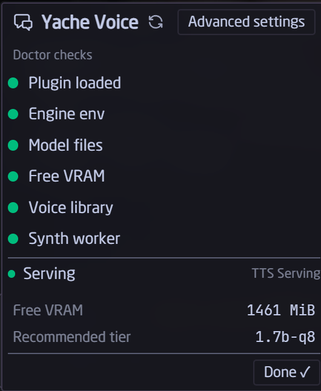
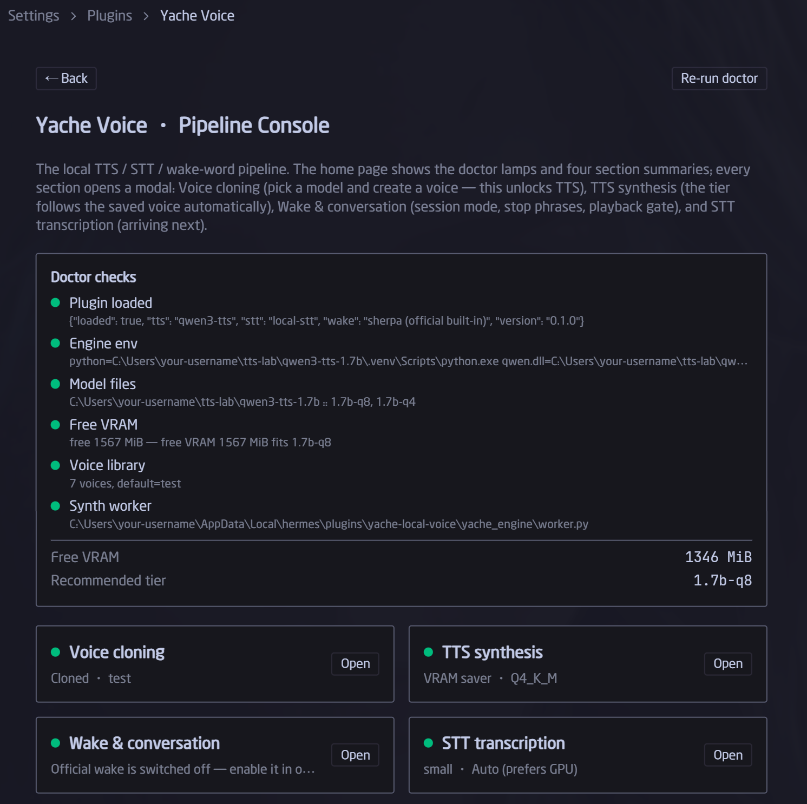
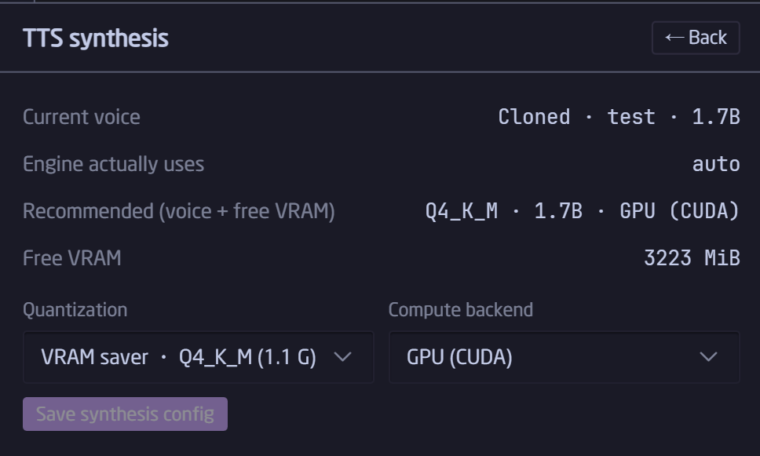
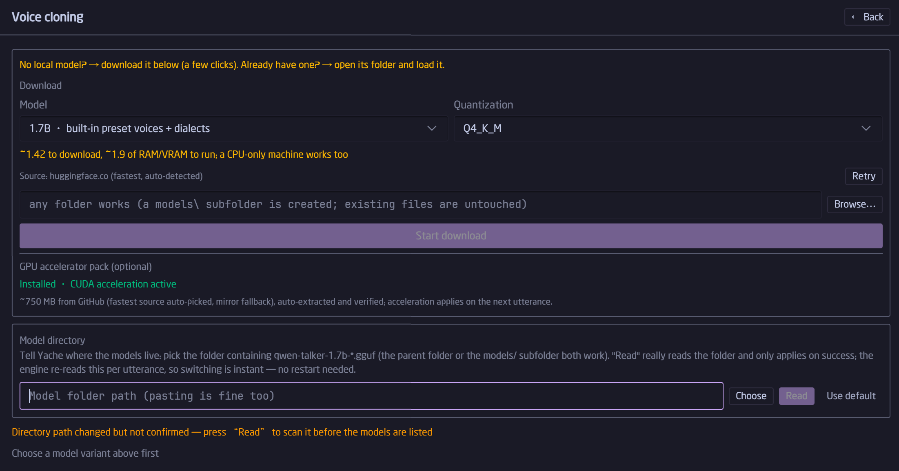
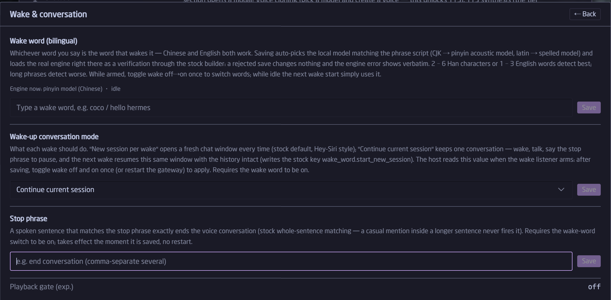
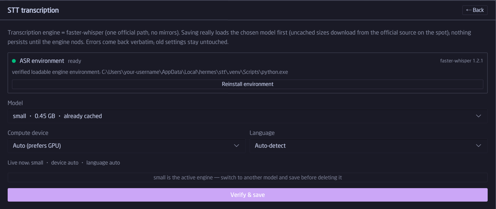

# Yache Voice (yache-local-voice)

One plugin, one full local voice pipeline for Hermes Desktop:

| Engine | What it does |
|---|---|
| **TTS** | Qwen3-TTS 1.7B via ggml `qwen.dll` — zero-disk streaming PCM playback, VRAM released right after each answer. Provider name `qwen3-tts` (host-config compatible). |
| **STT** | Local faster-whisper (CPU int8) inside a plugin-owned Python environment the panel can build in one click. Provider name `local-stt`. |
| **Wake word** | The host's **official built-in** sherpa-onnx KWS engine (`wake_word.provider: sherpa`). This plugin does not replace it; its dashboard just exposes the official settings. |

Nothing is fetched behind your back: every download (the speech-to-text
environment, a whisper model) happens only when you press a button in the
panel. A missing engine returns control to the host with a clear
diagnostic instead of substituting something else.

## Installation

A one-click install through the official Hermes plugin catalog is in the
review queue; until it lands, use the manual route below (about one minute,
no command line required). The engines ship as Windows x64 binaries.

1. Download this repository (Code ▼ → **Download ZIP**, or `git clone`) and
   unzip it anywhere.
2. From the unzipped folder, copy everything **except** `desktop/`, `docs/`
   and dot-files (so: `__init__.py`, `plugin.yaml`, `dashboard/`,
   `vendor/`, `yache_engine/`, plus the license/changelog files) into a new
   folder:
   `%LOCALAPPDATA%\hermes\plugins\yache-local-voice\`
   Check: `...\plugins\yache-local-voice\plugin.yaml` must exist.
3. Copy the single file `desktop\plugin.js` to:
   `%LOCALAPPDATA%\hermes\desktop-plugins\yache-local-voice\plugin.js`
   (create the `yache-local-voice` folder if it does not exist — that one
   file is the whole UI panel).
4. **Quit the Hermes desktop app completely** and open it again. A full quit
   reloads both the gateway plugin and the panel; closing the window or
   pressing Ctrl+R is not enough.
5. A new icon appears in the status bar — click it, then open the console.
   Nothing is downloaded behind your back: press **Download model** on the
   TTS tab to fetch the Qwen3-TTS GGUF weights; NVIDIA users can install the
   CUDA acceleration pack (the GPU package in this repository's Releases,
   `yache-cuda-windows-x64.zip`, fetched on demand) from the same tab; the
   STT tab builds its own local transcription environment with one click.
   The first synthesized sentence is the acceptance test — if you hear it,
   everything downstream is wired correctly.

For a source install the layout is identical: the repository root *is* the
plugin body (skip `desktop/` and `docs/`), and `desktop/plugin.js` mirrors
to `desktop-plugins/yache-local-voice/plugin.js`.

## Screenshots

The one-glance status bar, the console doctor screen and the four settings pages:

*QuickPanel: engine state, VRAM hint and quick actions, always one click away in the status bar.*

*Console home: the doctor report — engine paths, versions and every health light in one screen.*

*TTS tab: pick a voice, type, listen — plus voice cloning in one click.*

*Cloning tab: model download ladder, CUDA accelerator status, and building a new voice from a reference clip.*

*Wake tab: tune the official sherpa-onnx keyword engine and hold full wake conversations.*

*STT tab: one-click build of the plugin-owned Python environment, offline transcription of files or microphone.*

## Disclosure (catalog rule 13)

- **Config keys written by the dashboard panel** (through the official
  config writer, `hermes_cli.config`):
  - `voice.stop_phrases` — voice-conversation stop-word table
  - `wake_word.start_new_session` — continue current session vs start a
    new one on wake
  - `wake_word.phrase` + `wake_word.sherpa.model_dir` — wake-phrase
    editor (saved only after the engine really loads the new model)
  - `stt.local.model` + `stt.local.language` — speech-to-text engine
    selection (saved only after a real offline load + silence probe)
  These keys also have official settings elsewhere in the app; the
  panel is a convenience editor, not a parallel store.
- **Spawns short-lived worker subprocesses** for TTS synthesis and STT
  transcription (the plugin's own scripts under `yache_engine/`, plus
  the user-provided engine runtimes described below). No arbitrary
  shell commands.
- **Network**: two user-clicked fetches, nothing else. (1) The ASR
  environment install, which downloads packages through the pip mirror
  you already configured, with one automatic retry against pypi.org when
  the mirror lacks one; (2) the STT model download, which pulls a
  faster-whisper model from huggingface.co into the standard Hugging Face
  cache (`HF_HOME`). Save/verify probes only use what is already cached,
  and no runtime download happens on its own.
- **GPU**: TTS synthesis loads a ~2 GB model into VRAM and releases it
  after every playback; a pre-flight free-VRAM gate automatically falls
  back to CPU when the chat model occupies the GPU.
- **No credentials**: everything runs locally; no API keys are read or
  stored.
- **Model files are user-provided** (Qwen3-TTS GGUF tier; the Python
  environment whisper needs is built by the panel's installer into
  `HERMES_HOME/stt/.venv`). Voice-clone registration appends entries to
  the shared `HERMES_HOME/voices/registry.json` and writes the clip
  under `HERMES_HOME/voices/`. Paths resolve via `YACHE_*` env vars →
  `HERMES_HOME/yache-voice.json` → platform defaults; the panel shows
  what is missing. The wake word model cache (~13–16 MB) is downloaded
  by Hermes core itself, not by this plugin.

## Speech-to-text environment (survives Hermes upgrades)

Speech recognition needs two Python packages that Hermes core does not ship
(faster-whisper and PyAV). They go into an environment the plugin owns,
never into the gateway's own Python environment:

    <HERMES_HOME>/stt/.venv

`<HERMES_HOME>` is where Hermes keeps your data: `%LOCALAPPDATA%\hermes` on
Windows, `~/.hermes` on Linux and macOS. The official updater replaces the
gateway environment every time it changes dependencies, so anything
installed there disappears quietly — speech recognition included. This
folder is outside that reach: upgrading Hermes (new source, new gateway
environment, new dependency lock) leaves it in place and the plugin keeps
working with no reinstall.

**How to install it:** open the panel's speech-to-text section and press
"安装 ASR 环境 / Install ASR environment". The section first states what is
missing (no environment / environment without the engine / engine
verified / an external interpreter in use), and the button is the only
thing that touches the network. A full install runs four steps — wipe,
create the environment, download packages, verify — and the panel follows
them live from the same routes (`GET /stt/env/install/status` reports the
current step, a step-based percentage and elapsed seconds), so what the
bar shows is what the process actually completed. When only the packages
are missing the run shrinks to two steps (pip, verify) and repairs the
environment in place instead of rebuilding it. Pressing again while a run
is in flight is refused rather than stacked, and a rebuild is offered once
the environment is ready.

On where the packages come from: the first attempt lets pip use whatever
index is already configured on the machine (a corporate or CN mirror works
as usual), and only if that attempt fails does it retry once against
`pypi.org`; the job records which one served the packages, so a slow mirror
is visible in the log rather than guessed at. Nothing is upgraded or
touched outside `<HERMES_HOME>/stt/.venv` — the system Python, the Hermes
runtime and every other plugin keep their own dependencies.

Nothing is called ready before it works: the last step really starts a
worker inside the new environment, imports faster-whisper there and reads
its version back, and the row only shows the engine as verified once that
came back (the same probe runs again whenever the section is opened, so a
half-deleted environment cannot keep claiming to be fine). A failed step
keeps its error plus the log tail in the panel. The row also reports the
free space on the drive, and a fresh install refuses to start below 1.5 GB,
because the environment plus the first whisper model need that room.

**Already have a Python where faster-whisper works** (shared with another
tool)? Put its interpreter path into the panel's interpreter field. The
plugin uses that path for as long as it verifiably loads faster-whisper and
falls back to its own environment the moment it stops working. Empty means
"use the plugin's own environment", which is the upgrade-proof default.

## Optional experimental: read-aloud wake gate

`HERMES_HOME/yache-voice.json` may set `"wake_gate": true` (default
false = stock wake semantics). When on, the plugin asks the live wake
detector to ignore its own TTS audio mid-answer. This is a fail-soft
read of host state, not a behaviour takeover; a host-side half-duplex
hook would make it obsolete.

## Version history

- **0.1.0** (2026-11-19) — first public release: local voice-cloning TTS (Qwen3-TTS 1.7B), self-managed STT environment with on-demand install and weights download wizard, wake word on the official built-in sherpa-onnx KWS engine, and a one-click CUDA accelerator pack shipped as GitHub Release asset `cuda-pack-v1`.
